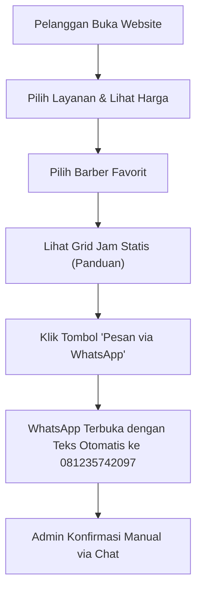

# 📄 PRODUCT REQUIREMENT DOCUMENT (PRD) — FINAL
## Website Barbershop — Paket Mulai (Landing Page & WhatsApp Direct)
**Nama Produk:** SETARA Barbershop Web — Paket Mulai
**Versi Dokumen:** 3.1.0 (Final Executable)
**Harga Jual:** Rp 1.150.000 (Termasuk Domain `.my.id` & Hosting 1 Tahun)
**Status:** Siap Eksekusi (Ready for AI Agent / Developer Team)
**Tech Stack:** Next.js 14 (App Router) + Tailwind CSS (Static Site / SSG)

---

### 1. Ringkasan Produk
**Product concept**
Website barbershop **SETARA** adalah platform berbasis web statis yang berfungsi sebagai *company profile* profesional. Website ini menampilkan katalog layanan, profil barber, galeri foto, dan lokasi, serta mempermudah pelanggan memesan langsung melalui WhatsApp. Dilengkapi dengan tampilan grid jam statis sebagai panduan, tanpa perlu sistem *database* atau *dashboard* admin yang rumit.

| Parameter | Spesifikasi |
| :--- | :--- |
| **Nama Bisnis** | SETARA BARBERSHOP |
| **Target pengguna** | Masyarakat umum (pria, anak-anak, dewasa) di Tanggul, Jember |
| **Konsep produk** | *Company Profile* + *WhatsApp Direct Booking* + *Static Time Grid* |
| **Model operasional** | *Single operator* (Pengelola konten via kode) |
| **Backend & Stack** | Next.js 14 (App Router) + Tailwind CSS (Tanpa Database/Backend) |
| **Platform** | Web (Mobile-First & Responsive) |
| **Desain UI** | Clean Modern Light (Putih/Abu Terang, aksen emas/hitam tipis) |

---

### 2. Latar Belakang dan Masalah
#### 2.1 Latar Belakang
Masyarakat membutuhkan akses yang cepat, akurat, dan terpercaya untuk mendapatkan informasi layanan barbershop tanpa proses manual yang berbelit. Website ini dirancang untuk memusatkan katalog layanan, profil barber, dan pemrosesan pesanan via WhatsApp dalam satu platform digital yang terstruktur.

#### 2.2 Problem Statement
- Pelanggan membutuhkan cara untuk menemukan pilihan layanan yang sesuai kebutuhan dan anggaran secara transparan.
- Pelanggan ingin memeriksa harga dan durasi layanan tanpa harus bolak-balik bertanya manual.
- Pelanggan ingin melakukan pemesanan langsung dengan format yang jelas ke WhatsApp admin.
- Pelanggan ingin melihat portofolio dan profil barber untuk meningkatkan kepercayaan.

#### 2.3 Tujuan Produk
- Mempermudah pelanggan menemukan layanan sesuai kebutuhan.
- Menyediakan katalog terpusat dengan informasi harga yang jelas.
- Memungkinkan pemrosesan pesanan instan via WhatsApp dengan format otomatis.
- Meningkatkan citra profesional barbershop di mata pelanggan.

#### 2.4 Batasan Produk (Paket Mulai)
- **Tidak ada Sistem Booking Slot (Anti-Bentrok):** Tidak ada pengecekan ketersediaan jam secara *real-time* dan tidak ada penguncian slot. Grid jam hanya bersifat statis sebagai panduan.
- **Tidak ada Dashboard Admin:** Perubahan konten (harga, foto, teks) dilakukan secara statis melalui *file code* dan *deploy* ulang.
- **Tidak ada Payment Gateway Otomatis:** Pembayaran dilakukan di tempat (Cash/QRIS statis).
- **Tidak ada WhatsApp API Berbayar:** Notifikasi menggunakan metode *deep link* `wa.me` (1-klik).
- **Tidak ada Akun Pelanggan:** Pelanggan langsung *checkout* via WhatsApp.
- **Tidak ada Multi-Cabang & Aplikasi Native.**

---

### 3. Pengguna, Role, dan Hak Akses (Role Matrix)
| Role | Tanggung Jawab |
| :--- | :--- |
| **Pelanggan (Guest)** | Menjelajahi beranda, galeri, katalog layanan, melihat profil barber, melihat grid jam statis, dan mengklik tombol WhatsApp untuk memesan. |
| **Admin / Pengembang** | Mengubah data statis (harga, foto, teks, jam operasional) di dalam *file code* (`data/*.ts`) dan melakukan *deploy* ulang ke hosting (Vercel). |

---

### 4. Ruang Lingkup dan Fitur Fungsional (Functional Requirements)

#### 4.1 Halaman Publik
* **FR-01: Beranda & Profil Barbershop**
  Menampilkan *Hero Section* (nama "SETARA BARBERSHOP", tagline, CTA "Booking Sekarang"), profil singkat, **Jam Operasional Toko**, alamat lokasi (Tanggul, Jember), dan **Section Testimoni Pelanggan**.
* **FR-02: Galeri Foto Portofolio**
  Menampilkan kisi-kisi (*grid*) foto hasil potongan rambut terbaik dari data statis.
* **FR-03: Katalog Layanan & Harga**
  Halaman daftar layanan (potong rambut, cuci, perawatan) lengkap dengan deskripsi, harga, dan durasi. Tombol "Pesan via WA" mengarah ke WhatsApp.
* **FR-04: Pilih Barber Spesifik**
  Pelanggan dapat melihat daftar kapster yang tersedia (foto, nama, bio singkat) dan memilih kapster favorit.
* **FR-05: Halaman Kontak & Lokasi**
  Menampilkan alamat lengkap, *embed* Google Maps, jam operasional, tombol WA langsung ke nomor **081235742097**, dan **Section FAQ**.

#### 4.2 Tampilan Grid Jam Statis & Integrasi WhatsApp
* **FR-06: Tampilan Grid Jam Statis (Static Time Grid)**
  Di halaman Layanan/Booking, tampilkan daftar slot jam (interval 40 menit) dari jam operasional.
  - Semua jam ditampilkan dengan warna sama (tidak ada status "penuh").
  - Jam **tidak bisa diklik** — hanya sebagai panduan visual.
  - Di bawah grid ada *warning*: *"Ketersediaan jam belum real-time. Silakan konfirmasi ke admin via WhatsApp."*
* **FR-07: Tombol Chat WhatsApp Direct & Floating WA**
  Tombol "Pesan Sekarang" di setiap kartu layanan, serta **Tombol Floating WhatsApp** (melingkar di pojok kanan bawah) yang selalu muncul di semua halaman. Klik tombol akan membuka WhatsApp ke nomor **081235742097**.
* **FR-08: Format Pesan Otomatis**
  Pesan WhatsApp yang terisi otomatis: 
  `Halo Admin SETARA Barbershop, saya ingin booking layanan [Nama Layanan] dengan barber [Nama Barber] untuk hari [Hari/Tanggal] jam [Jam yang dipilih]. Apakah slotnya tersedia?`

#### 4.3 Alur Pemesanan Utama


---

### 5. Business Rules (Aturan Bisnis)
| ID | Aturan Bisnis |
| :--- | :--- |
| **BR-01** | Semua harga disimpan dalam Rupiah (IDR) dan di-*format* dengan pemisah ribuan (contoh: Rp 20.000). |
| **BR-02** | Data layanan, barber, galeri, testimoni, dan FAQ bersifat statis (di-*hardcode* di folder `data/`). Perubahan data harus melalui *update code* dan *deploy* ulang. |
| **BR-03** | Tombol WhatsApp wajib menggunakan *URL Encode* (`encodeURIComponent`) agar format teks pesan rapi saat dikirim. |
| **BR-04** | Nomor WhatsApp admin disimpan dalam variabel konfigurasi (`lib/constants.ts`) agar mudah diubah. |
| **BR-05** | Grid jam statis hanya menampilkan jam dari jam operasional (Senin tutup, Selasa–Minggu 11:00–21:00, Jumat 13:00–21:00). Tidak ada validasi ketersediaan *real-time*. |
| **BR-06** | Data Testimoni dan FAQ di-*hardcode* di folder `data/` dan dapat diubah kapan saja oleh pengembang. |

---

### 6. Acceptance Criteria (Kriteria Keberhasilan)
* **AC-01 — Katalog & Informasi:** Pelanggan dapat melihat daftar layanan, harga, dan durasi. Halaman galeri menampilkan foto dengan *layout grid* yang responsif.
* **AC-02 — Pemilihan Barber:** Pelanggan dapat melihat profil barber (foto & nama). Data barber yang tidak aktif tidak ditampilkan.
* **AC-03 — Grid Jam Statis:** Grid jam tampil di halaman booking, semua jam berwarna sama, tidak bisa diklik, dan ada *warning* "Ketersediaan belum real-time".
* **AC-04 — Integrasi WhatsApp:** Tombol "Pesan Sekarang" & Floating WA membuka aplikasi WhatsApp (Web/App) dengan teks pesan otomatis terisi sesuai format FR-08. Nomor tujuan WA sesuai dengan konfigurasi admin (`6281235742097`).
* **AC-05 — Testimoni & FAQ:** Section Testimoni tampil di Beranda dan Section FAQ tampil di Kontak. Keduanya bersifat statis.
* **AC-06 — Responsivitas:** UI optimal pada resolusi *mobile* (360px) hingga *desktop* (1920px). Tidak ada *horizontal scroll* yang tidak diinginkan.
* **AC-07 — Local SEO:** Website memiliki *Meta Title*, *Description*, *OpenGraph*, dan *Schema.org LocalBusiness* untuk indeks Google Maps lokal.

---

### 7. Arsitektur Teknis & Rekomendasi Stack
Arsitektur yang direkomendasikan adalah **Static Site Generation (SSG)** menggunakan Next.js. Pendekatan ini meminimalkan biaya *hosting* (gratis di Vercel) dan mempercepat waktu *load*.

| Komponen | Rekomendasi |
| :--- | :--- |
| **Framework** | Next.js 14+ (App Router, TypeScript) |
| **Styling** | Tailwind CSS + Lucide React |
| **Data Layer** | File statis (`data/services.ts`, `data/barbers.ts`, `data/gallery.ts`, `data/testimonials.ts`, `data/faq.ts`) |
| **Integrasi WA** | Metode *Deep Link* `wa.me` (tanpa biaya API) |
| **Hosting** | Vercel (Hobby Plan) |
| **Domain** | `.my.id` (Tahun ke-1 gratis) |

#### 7.1 Struktur Folder yang Disarankan
```text
app/
├── layout.tsx
├── page.tsx                # Beranda (Hero, Testimoni, Jam Operasional)
├── layanan/page.tsx        # Katalog Layanan + Grid Jam Statis
├── galeri/page.tsx         # Galeri Foto
├── kontak/page.tsx         # Kontak, Maps, FAQ
├── components/
│   ├── Navbar.tsx
│   ├── Footer.tsx
│   ├── BarberCard.tsx
│   ├── ServiceCard.tsx
│   ├── TestimonialCard.tsx
│   ├── FAQItem.tsx
│   ├── StaticTimeGrid.tsx  # Grid Jam Statis (FR-06)
│   └── FloatingWhatsApp.tsx
├── data/
│   ├── services.ts         # Data Layanan (Statis)
│   ├── barbers.ts          # Data Barber (Statis)
│   ├── gallery.ts          # Data Galeri (Statis)
│   ├── testimonials.ts     # Data Testimoni (Statis)
│   └── faq.ts              # Data FAQ (Statis)
└── lib/
    ├── constants.ts        # Nomor WA, Alamat, Nama Bisnis
    └── wa-helper.ts        # Fungsi generate link WA
```

---

### 8. Rancangan Data Statis (`data/`)
Karena tidak pakai database, data disimpan di file TypeScript:

**`data/services.ts`**
```typescript
export const services = [
  { id: 1, name: "Potong Rambut", price: 30000, duration: 40, description: "Potong rambut pria" },
  { id: 2, name: "Cuci + Potong", price: 45000, duration: 50, description: "Cuci rambut + potong" },
  // ...
]
```

**`data/barbers.ts`**
```typescript
export const barbers = [
  { id: 1, name: "Rizky", bio: "Spesialis fade & pompadour", photo: "/images/barber-1.jpg" },
  { id: 2, name: "Andi", bio: "Spesialis classic cut", photo: "/images/barber-2.jpg" },
]
```

**`data/testimonials.ts`**
```typescript
export const testimonials = [
  { id: 1, name: "Budi", review: "Hasil potongannya rapi, pelayanannya ramah!", rating: 5 },
  { id: 2, name: "Sandi", review: "Tempatnya bersih dan nyaman. Recommended!", rating: 5 },
  { id: 3, name: "Eko", review: "Harga terjangkau, hasil memuaskan.", rating: 4 },
]
```

**`data/faq.ts`**
```typescript
export const faqs = [
  { id: 1, q: "Jam berapa barbershop buka?", a: "Kami buka Selasa–Minggu jam 11:00–21:00. Senin tutup." },
  { id: 2, q: "Apakah bisa booking untuk anak?", a: "Bisa, kami melayani potong rambut untuk anak-anak." },
  { id: 3, q: "Apakah ada parkir?", a: "Ya, tersedia area parkir gratis di depan toko." },
  { id: 4, q: "Metode pembayaran apa saja?", a: "Kami menerima tunai dan QRIS." },
  { id: 5, q: "Berapa lama durasi potong rambut?", a: "Sekitar 40 menit per sesi." },
]
```

**`lib/constants.ts`**
```typescript
export const WHATSAPP_NUMBER = "6281235742097"; // format internasional dari 081235742097
export const BUSINESS_NAME = "SETARA BARBERSHOP";
export const ADDRESS = "Tanggul, Jember";
```

---

### 9. Backlog Pengembangan Berprioritas (Milestone)
| ID | Epic / Task | Prioritas | Dependency |
| :--- | :--- | :--- | :--- |
| **BK-01** | Setup Next.js 14 + Tailwind + Struktur Folder | P0 | — |
| **BK-02** | Membuat file data statis (`services`, `barbers`, `gallery`, `testimonials`, `faq`, `constants`) | P0 | BK-01 |
| **BK-03** | Membuat komponen Global (Navbar, Footer, FloatingWhatsApp) | P0 | BK-01 |
| **BK-04** | Membuat Halaman Beranda (Hero, Layanan Preview, Barber, Testimoni, Jam Operasional) | P0 | BK-02, BK-03 |
| **BK-05** | Membuat Halaman Katalog Layanan & Galeri | P0 | BK-02 |
| **BK-06** | Membuat komponen `StaticTimeGrid` (Grid Jam Statis) di halaman Layanan | P0 | BK-02 |
| **BK-07** | Membuat fungsi `wa-helper.ts` (URL Encode & Template Pesan) | P0 | BK-02 |
| **BK-08** | Integrasi tombol WA di Halaman Layanan, Barber, & Floating | P0 | BK-07 |
| **BK-09** | Membuat Halaman Kontak (Maps Embed, FAQ, Info) | P0 | BK-03 |
| **BK-10** | Polishing UI/UX (Responsif Mobile & Desktop, Clean Modern Light) | P0 | BK-04, BK-05, BK-09 |
| **BK-11** | Tambahkan Local SEO (Schema.org LocalBusiness & Meta Tags) | P0 | BK-10 |
| **BK-12** | Deploy ke Vercel & Hubungkan Domain `.my.id` | P0 | BK-11 |

#### Urutan Milestone
- **Milestone 1 — Foundation:** Setup project, data statis, dan komponen dasar.
- **Milestone 2 — Core Pages:** Beranda, Layanan (dengan Grid Jam), Galeri, Kontak.
- **Milestone 3 — Integration:** Fungsi WhatsApp, Testimoni, FAQ, Floating WA.
- **Milestone 4 — Launch:** Polishing UI, Local SEO, dan *deploy* ke domain.

---

### 10. Non-Functional Requirements (NFR)
| ID | Requirement | Kriteria |
| :--- | :--- | :--- |
| **NFR-01** | Performance | *Load time* halaman < 2 detik (karena SSG). |
| **NFR-02** | SEO | Menggunakan *Metadata* Next.js (Title, Description, OG Image) + *Schema.org LocalBusiness*. |
| **NFR-03** | Responsiveness | UI optimal pada resolusi *mobile* (360px) hingga *desktop* (1920px). |
| **NFR-04** | Maintainability | Data terpusat di folder `data/` agar mudah diubah tanpa menyentuh komponen UI. |

---

### 11. Asumsi & Keputusan Final
- **Notifikasi WhatsApp:** Menggunakan metode *deep link* `wa.me` (1-klik). **Nomor Admin: 081235742097 (format internasional: 6281235742097).**
- **Pembayaran:** Cash/QRIS statis di tempat.
- **Desain:** Clean Modern Light (putih/abu terang, aksen emas/hitam tipis).
- **Grid Jam:** Statis (hanya panduan visual, tidak bisa diklik, tidak ada cek ketersediaan *real-time*).
- **Foto & Konten:** Menggunakan *placeholder* sampai klien memberikan aset asli.
- **Biaya Operasional:** Rp 0/bulan (tanpa API berbayar).
- **Dukungan Teknis:** Perubahan konten setelah *go-live* dapat dikenakan biaya tambahan (karena tidak ada Dashboard Admin).

---

### 12. Definition of Done (DoD)
MVP dinyatakan siap rilis ketika:
1. [ ] Pelanggan dapat melihat katalog layanan, daftar barber, testimoni, dan FAQ.
2. [ ] Grid jam statis tampil di halaman Layanan dengan *warning* "Ketersediaan belum real-time".
3. [ ] Tombol WhatsApp (termasuk Floating WA) berfungsi dan membuka chat dengan format pesan yang benar (ke nomor 6281235742097).
4. [ ] Halaman responsif di *mobile* dan *desktop* (360px–1920px).
5. [ ] Website memiliki *Meta Tags* & *Schema.org LocalBusiness*.
6. [ ] Website berhasil di-*deploy* ke Vercel dan terhubung ke domain `.my.id`.
7. [ ] Seluruh *acceptance criteria* lolos pengujian manual.

---

### 13. Rekomendasi Keputusan Sebelum Coding (Sudah Final)
1. **Nomor WhatsApp Admin:** 081235742097 (format internasional: 6281235742097). ✅
2. **Desain UI:** Clean Modern Light. ✅
3. **Seed Data:** SETARA BARBERSHOP + 2 barber dummy + layanan dummy + 3 testimoni + 5 FAQ. ✅
4. **Harga Layanan Awal (Dummy):** Potong Rambut Rp 30.000, Cuci + Potong Rp 45.000. ✅
5. **Grid Jam:** Statis (hanya tampilan panduan). ✅

---

**Kesimpulan:** PRD Paket Mulai v3.1.0 ini sudah **100% FINAL**, mencakup seluruh fitur yang dijanjikan di tabel harga Paket Mulai, ditambah *bonus* Testimoni, FAQ, Floating WA, dan Grid Jam Statis agar website terlihat lebih profesional tanpa menambah biaya *coding*. Kamu bisa langsung gunakan dokumen ini untuk *coding* atau sebagai lampiran penawaran ke klien. 🚀